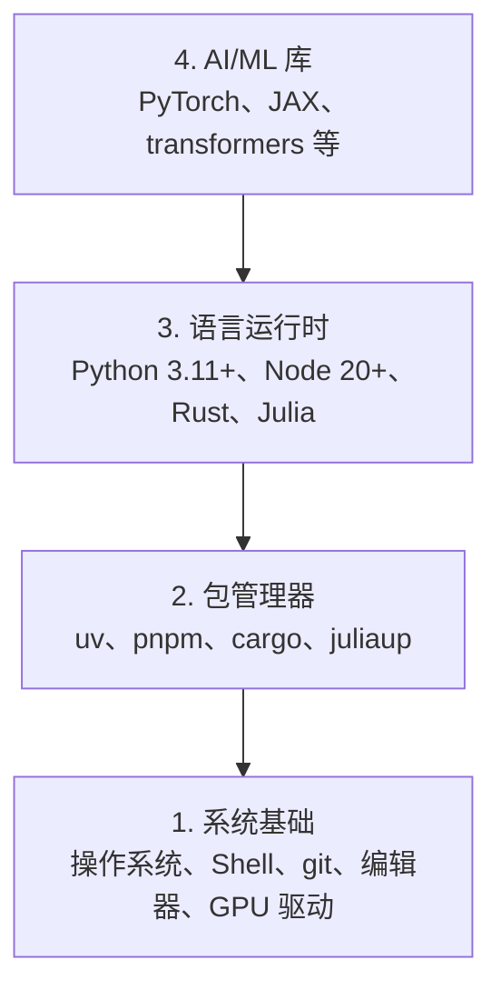

# 开发环境

> 你的工具会塑造你的思维方式。一次设置好，并把它设置正确。

**类型：** Build
**语言：** Python、Node.js、Rust
**前置知识：** 无
**预计时间：** 约 45 分钟

## 学习目标

- 从零开始配置 Python 3.11+、Node.js 20+ 和 Rust 工具链
- 配置虚拟环境和包管理器，实现可复现构建
- 使用 CUDA/MPS 验证 GPU 访问，并运行一次张量操作
- 理解四层技术栈：系统、软件包、运行时和 AI 库

## 问题

接下来，你将使用 Python、TypeScript、Rust 和 Julia 学习 200 多个 AI 工程课程。如果开发环境有问题，每一节课都会变成与工具链斗争，而不是专注于学习。

大多数人会跳过环境配置，随后却花费数小时调试导入错误、版本冲突和缺失的 CUDA 驱动。我们要一次性把这件事做好。

## 概念

一个 AI 工程开发环境包含四层：



我们从底层向上安装，因为每一层都依赖下面那一层。

## 动手构建

### 第 1 步：系统基础

检查你的系统并安装基础工具。

```bash
# macOS
xcode-select --install
brew install git curl wget

# Ubuntu/Debian
sudo apt update && sudo apt install -y build-essential git curl wget

# Windows（使用 WSL2）
wsl --install -d Ubuntu-24.04
```

### 第 2 步：使用 uv 配置 Python

我们使用 `uv`——它比 pip 快 10 到 100 倍，并且能够自动管理虚拟环境。

```bash
curl -LsSf https://astral.sh/uv/install.sh | sh

uv python install 3.12

uv venv
source .venv/bin/activate  # Windows 上使用 .venv\\Scripts\\activate

uv pip install numpy matplotlib jupyter
```

验证安装：

```python
import sys
print(f"Python {sys.version}")

import numpy as np
print(f"NumPy {np.__version__}")
a = np.array([1, 2, 3])
print(f"向量：{a}，与自身的点积：{np.dot(a, a)}")
```

### 第 3 步：使用 pnpm 配置 Node.js

TypeScript 课程会使用 Node.js（包括智能体、MCP 服务器和 Web 应用）。

```bash
curl -fsSL https://fnm.vercel.app/install | bash
fnm install 22
fnm use 22

npm install -g pnpm

node -e "console.log('Node', process.version)"
```

### 第 4 步：配置 Rust

Rust 用于性能敏感的课程（推理、系统开发）。

```bash
curl --proto '=https' --tlsv1.2 -sSf https://sh.rustup.rs | sh

rustc --version
cargo --version
```

### 第 5 步：Julia（可选）

Julia 适合数学密集型课程。

```bash
curl -fsSL https://install.julialang.org | sh

julia -e 'println("Julia ", VERSION)'
```

### 第 6 步：配置 GPU（如果你有 GPU）

```bash
# NVIDIA
nvidia-smi

# 安装支持 CUDA 的 PyTorch
uv pip install torch torchvision torchaudio --index-url https://download.pytorch.org/whl/cu124
```

```python
import torch
print(f"CUDA 可用：{torch.cuda.is_available()}")
if torch.cuda.is_available():
    print(f"GPU：{torch.cuda.get_device_name(0)}")
```

没有 GPU 也没关系。大多数课程都可以在 CPU 上运行。对于训练量较大的课程，可以使用 Google Colab 或云 GPU。

### 第 7 步：验证所有配置

运行验证脚本：

```bash
python phases/00-setup-and-tooling/01-dev-environment/code/verify.py
```

## 使用环境

现在，你的环境已经可以支持本课程的所有内容。不同课程中的使用情况如下：

| 语言 | 使用范围 | 包管理器 |
|------|----------|----------|
| Python | Phase 1-12（机器学习、深度学习、NLP、视觉、音频、LLM） | uv |
| TypeScript | Phase 13-17（工具、智能体、群体智能体、基础设施） | pnpm |
| Rust | Phase 12、15-17（性能敏感型系统） | cargo |
| Julia | Phase 1（数学基础） | Pkg |

## 交付成果

本单元会产出一个验证脚本，任何人都可以运行它来检查自己的开发环境。

参见 `outputs/prompt-env-check.md`，其中有一个帮助 AI 助手诊断环境问题的提示词。

## 练习

1. 运行验证脚本并修复所有失败项
2. 为本课程创建一个 Python 虚拟环境并安装 PyTorch
3. 用四种语言分别编写并运行一个“Hello, World!”程序
