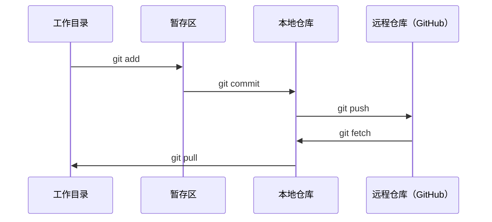

# Git 与协作

> 版本控制不是可选项。你在这里完成的每一次实验、构建的每一个模型和学习的每一节课，都会被记录下来。

**类型：** Learn
**语言：** --
**前置知识：** 阶段 0，第 01 课
**预计时间：** 约 30 分钟

## 学习目标

- 配置 Git 用户身份，并掌握 add、commit 和 push 的日常工作流程
- 创建并合并分支，在不破坏 main 分支的情况下进行隔离实验
- 编写 `.gitignore`，排除模型检查点和大型二进制文件
- 使用 `git log` 浏览提交历史，了解项目的演进过程

## 问题

接下来，你将在 20 个阶段中编写数百个代码文件。没有版本控制，你会丢失工作成果、造成无法撤销的破坏，也无法与其他人协作。

Git 是我们要使用的工具，GitHub 是存放代码的地方。本课只介绍完成这门课程所需要的内容，不做额外展开。

## 核心概念



需要记住三件事：

1. 经常保存（`git commit`）
2. 推送到远程仓库（`git push`）
3. 使用分支进行实验（`git checkout -b experiment`）

## 动手构建

### 第 1 步：配置 Git

```bash
git config --global user.name "Your Name"
git config --global user.email "you@example.com"
```

### 第 2 步：日常工作流程

```bash
git status
git add file.py
git commit -m "Add perceptron implementation"
git push origin main
```

### 第 3 步：使用分支进行实验

```bash
git checkout -b experiment/new-optimizer

# ……进行修改并提交……

git checkout main
git merge experiment/new-optimizer
```

### 第 4 步：在本课程仓库中工作

```bash
git clone https://github.com/rohitg00/ai-engineering-from-scratch.git
cd ai-engineering-from-scratch

git checkout -b my-progress
# 学习各节课程，并提交你的代码
git push origin my-progress
```

## 实际使用

在本课程中，你只需要掌握以下命令：

| 命令 | 使用场景 |
|------|----------|
| `git clone` | 获取课程仓库 |
| `git add` + `git commit` | 保存你的工作成果 |
| `git push` | 将成果备份到 GitHub |
| `git checkout -b` | 在不破坏 main 分支的情况下尝试新内容 |
| `git log --oneline` | 查看自己完成过的工作 |

就这些。学习本课程不需要使用 rebase、cherry-pick 或 submodule。

## 练习

1. 克隆本仓库，创建名为 `my-progress` 的分支，新建一个文件，提交并推送它
2. 创建一个 `.gitignore`，排除模型检查点文件（`.pt`、`.pth`、`.safetensors`）
3. 使用 `git log --oneline` 查看本仓库的提交历史，了解各节课程是如何添加进来的

## 关键术语

| 术语 | 人们通常怎么说 | 它的实际含义 |
|------|----------------|--------------|
| Commit（提交） | “保存” | 项目在某个时间点的完整快照 |
| Branch（分支） | “副本” | 指向某次提交的指针；它会随着你的工作不断向前移动 |
| Merge（合并） | “合并代码” | 获取一个分支中的修改，并将其应用到另一个分支 |
| Remote（远程仓库） | “云端” | 托管在其他位置的仓库副本，例如 GitHub 或 GitLab |
