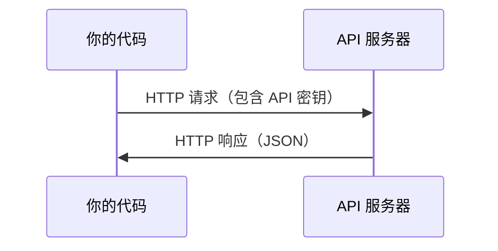

# API 与密钥

> 所有 AI API 的基本模式都一样：发送请求，获得响应。细节会变化，模式不会。

**类型：** Build  
**语言：** Python、TypeScript  
**前置知识：** Phase 0，第 01 课  
**预计时间：** 约 30 分钟

## 学习目标

- 使用环境变量和 `.env` 文件安全保存 API 密钥
- 使用 Anthropic Python SDK 和原始 HTTP 发起 LLM API 调用
- 对比 SDK 与原始 HTTP 的请求/响应格式，方便调试
- 识别并处理认证失败、限流等常见 API 错误

## 基本模式

每次 API 调用都包含四部分：URL 端点、用于认证的 API 密钥、请求体，以及响应体。



## 安全保存密钥

不要把密钥写进代码或提交到 Git：

```bash
export ANTHROPIC_API_KEY="sk-ant-..."
export OPENAI_API_KEY="sk-..."
```

也可以使用 `.env` 文件，但必须把它加入 `.gitignore`：

```text
ANTHROPIC_API_KEY=sk-ant-...
OPENAI_API_KEY=sk-...
```

## Python 调用示例

```python
import anthropic

client = anthropic.Anthropic()
response = client.messages.create(
    model="claude-sonnet-4-20250514",
    max_tokens=256,
    messages=[{"role": "user", "content": "What is a neural network in one sentence?"}]
)
print(response.content[0].text)
```

## 调试 API

先用 SDK 快速验证，再用原始 HTTP 检查请求头、JSON 结构和状态码。遇到 401 检查密钥，遇到 429 进行退避重试，遇到 5xx 记录响应并稍后重试。不要在日志中输出完整密钥。
